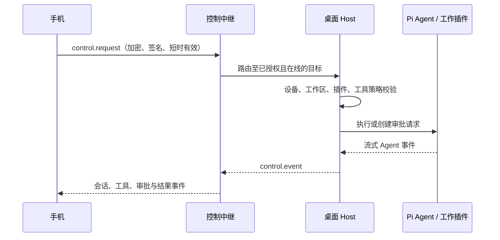

# 账号、设备与远程控制

## 双通道模型

同步和实时控制必须分离：

| 通道 | 用途 | 离线行为 | 目标 |
|---|---|---|---|
| 同步通道 | 工作区、会话、任务、产物、插件配置和审批历史 | 可排队、重放、冲突处理 | 所有成员设备 |
| 控制通道 | 发 prompt、停止运行、远程审批和会话实时事件 | 不可重放；超时即拒绝 | 已授权且在线的桌面 Host |

手机不应 SSH、Shell、直接连接桌面局域网地址或持有桌面密钥。手机和桌面都对控制中继建立认证后的**出站** WebSocket。



## 身份与设备

- 身份：OIDC + PKCE；优先支持 Passkey/WebAuthn。
- 每次安装生成唯一 `deviceId` 和设备密钥对。
- refresh token 仅存系统 Keychain/Keystore；access token 短期有效。
- 同一账号不等于自动可控制同账号的桌面设备。
- 工作区权限、设备授权和插件 capability 必须共同满足。

## 配对

1. 桌面登录并向服务端登记设备公钥。
2. 桌面显示一次性、短时有效二维码。
3. 手机登录，提交配对令牌和自己的设备公钥。
4. 服务端将手机设备名、密钥指纹和请求范围送往桌面确认。
5. 桌面确认目标工作区与控制范围。
6. 服务端签发按工作区和目标设备限制的授权。

配对码不得携带长期凭据；必须可撤销、过期，并对重复使用拒绝。

## 控制请求

```ts
type ControlRequest = {
  requestId: string;
  expiresAt: string;
  sourceDeviceId: string;
  targetDeviceId: string;
  workspaceId: string;
  pluginId: string;
  operation:
    | "session.view"
    | "session.prompt"
    | "session.stop"
    | "approval.respond";
  payloadCiphertext: Uint8Array;
  signature: Uint8Array;
};
```

目标 Host 必须验证：请求有效期、来源设备、目标设备、工作区成员资格、配对授权、插件支持的远程操作和本地工作区策略。任意失败都拒绝且记审计。

## 角色

| 角色 | 典型权限 |
|---|---|
| Owner | 工作区、成员、设备、策略和密钥轮换 |
| Maintainer | 管理插件、启动任务、配置 Agent |
| Contributor | 读写内容、发起 Agent 任务 |
| Viewer | 只读会话、产物和任务 |
| Remote Controller | 仅向指定桌面设备发控制命令 |

角色是第一层授权，不能替代设备配对、插件能力和最终工具策略。

## 移动端范围

手机可查看、搜索和继续会话，发送 prompt，停止运行，查看 token、thinking、工具调用、diff、产物、待办、子 Agent 和待审批请求。手机是否可批准高风险操作，由目标桌面的工作区策略决定；默认不允许远程批准写文件、Shell、删除、commit 或 push。
