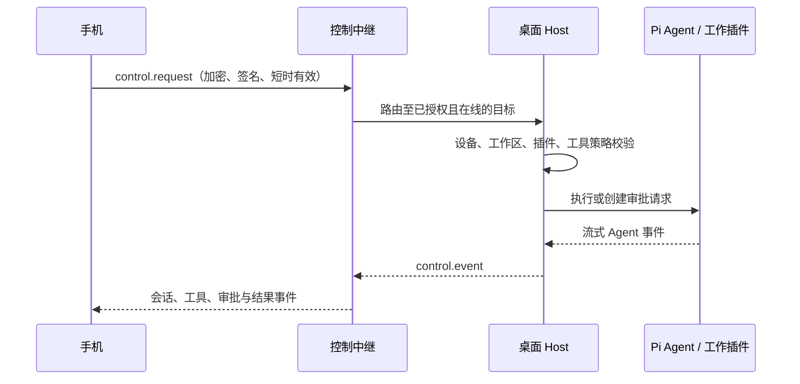

# 账号、设备与远程控制

## 双通道模型

同步和实时控制必须分离：

| 通道     | 用途                                         | 离线行为               | 目标                    |
| -------- | -------------------------------------------- | ---------------------- | ----------------------- |
| 同步通道 | 工作区、会话、任务、产物、插件配置和审批历史 | 可排队、重放、冲突处理 | 所有成员设备            |
| 控制通道 | 发 prompt、停止运行、远程审批和会话实时事件  | 不可重放；超时即拒绝   | 已授权且在线的桌面 Host |

手机不应 SSH、Shell、直接连接桌面局域网地址或持有桌面密钥。手机和桌面都对控制中继建立认证后的**出站** WebSocket。



## 身份与设备

- 身份：OIDC + PKCE；优先支持 Passkey/WebAuthn。
- 每次安装生成唯一 `deviceId` 和设备密钥对。
- refresh token 仅存系统 Keychain/Keystore；access token 短期有效。
- 同一账号不等于自动可控制同账号的桌面设备。
- 工作区权限、设备授权和插件 capability 必须共同满足。

## 配对

1. 桌面登录并向服务端登记设备公钥。
2. 桌面显示一次性、短时有效二维码。
3. 手机登录，提交配对令牌和自己的设备公钥。
4. 服务端将手机设备名、密钥指纹和请求范围送往桌面确认。
5. 桌面确认目标工作区与控制范围。
6. 服务端签发按工作区和目标设备限制的授权。

配对码不得携带长期凭据；必须可撤销、过期，并对重复使用拒绝。

## 控制请求

```ts
type ControlRequest = {
  requestId: string;
  expiresAt: string;
  sourceDeviceId: string;
  targetDeviceId: string;
  workspaceId: string;
  pluginId: string;
  operation:
    "session.view" | "session.prompt" | "session.stop" | "approval.respond";
  payloadCiphertext: Uint8Array;
  signature: Uint8Array;
};
```

目标 Host 必须验证：请求有效期、来源设备、目标设备、工作区成员资格、配对授权、插件支持的远程操作和本地工作区策略。任意失败都拒绝且记审计。

## 角色

| 角色              | 典型权限                           |
| ----------------- | ---------------------------------- |
| Owner             | 工作区、成员、设备、策略和密钥轮换 |
| Maintainer        | 管理插件、启动任务、配置 Agent     |
| Contributor       | 读写内容、发起 Agent 任务          |
| Viewer            | 只读会话、产物和任务               |
| Remote Controller | 仅向指定桌面设备发控制命令         |

角色是第一层授权，不能替代设备配对、插件能力和最终工具策略。

## 移动端范围

手机可查看、搜索和继续会话，发送 prompt，停止运行，查看 token、thinking、工具调用、diff、产物、待办、子 Agent 和待审批请求。手机是否可批准高风险操作，由目标桌面的工作区策略决定；默认不允许远程批准写文件、Shell、删除、commit 或 push。

### 当前移动界面

`apps/client/src/ClientRoot.tsx` 先读取真实 `HostSnapshot.platform`，在 iOS/Android 加载独立移动界面，桌面保留原 Percho 布局；不按屏幕宽度猜测宿主类型。移动端底部固定为“工作台 / Agent / 我的”，提供插件目录、桌面连接说明、账号/设备/同步状态、隐私说明和本机外观偏好。外观沿用 Host 的设备本地 preferences，保存失败显式报错。

账号与远控采用可自托管的 `apps/control-plane`（Fastify、PostgreSQL、oidc-provider）。客户端在设置内发起系统浏览器 OIDC Authorization Code + PKCE，使用应用 URI 回调，不启动本地 HTTP 服务。设备 Ed25519 签名密钥、X25519 交换私钥和 refresh token 只进入系统凭据库；凭据库不可用时拒绝登录，不回退明文文件。

同步采用按配对设备加密的会话快照与持久化 outbox；与短时有效、不落离线队列的控制信封分离。快照仅包含显式授权项目的会话数据，不同步工作区绝对路径、模型凭据、插件私密配置或本机偏好。双方确认密钥指纹后固定对端公钥；桌面以本机保存的项目和操作授权为最终依据，不信任服务端单独扩大权限。撤销后删除尚未交付的同步数据，未来消息使用新的随机 nonce；新配对重新确认公钥，撤销设备不再成为加密目标。

手机只可查看/恢复已存在会话、提交 prompt 和停止任务；写文件、Shell、MCP 等仍走桌面原有 capability broker 和审批。`approval.respond` 默认拒绝，不允许手机远程批准高风险工具。真实 iOS Keychain、URI 回调、WKWebView 与后台恢复仍须在 macOS/Xcode 真机验证。

### 自托管运行与已验证范围

1. 准备 PostgreSQL，设置 `DATABASE_URL` 与 `OIDC_ISSUER`（例如本机开发的 `http://127.0.0.1:8787/oidc`）。生产服务通过 HTTPS 提供；Rust 客户端只在 debug 模式允许本机 HTTP。
2. 设置 `NEXTTOOLS_ACCOUNT_PASSWORD` 后运行 `npm run account:create --workspace @nexttools/control-plane -- user@example.com` 创建账号（密码 12–256 字符）；密码不要写入仓库。运行 `npm run dev:server` 启动服务，或先 `npm run build:server` 后使用该 workspace 的 `start` 命令。
3. 桌面设置“账号与连接”输入服务根地址登录；移动端在“我的”登录同一账号。桌面生成一次性配对码，手机请求配对，双方核对公钥；桌面显式批准项目及查看/发送/停止范围。桌面退出会撤销当前设备并删除系统凭据。
4. 集成回归使用独立随机 PostgreSQL schema：设置 `TEST_DATABASE_URL` 后运行 `npm test --workspace @nexttools/control-plane`，覆盖真实 OIDC/PKCE、加密快照和控制、重复请求、过期、越权、高风险审批拒绝与撤销。未设置数据库时该测试会跳过，不能视为通过。

已用真实 Windows Tauri 和独立协议手机端验证登录、桌面配对 UI、加密快照互操作、控制到达 Host、无权会话拒绝、重放/过期/高风险审批拒绝、撤销后清除同步数据及退出。协议手机端不是 iOS 真机；当前未配置 Provider/API Key，尚未验证远程 prompt 的真实模型回复、流式工具执行与审批完整闭环。移动浏览器只验证布局，不伪造 Host 或账号数据。

### iOS 开发

- 必须在 macOS 安装完整 Xcode、命令行工具及 Tauri iOS 所需工具链。当前 Windows 的 Tauri CLI 不提供 `ios` 子命令，不能编译、签名或验证 iOS 真机。
- 在仓库根目录安装依赖后运行 `npm run ios:init`，再运行 `npm run ios:dev` 或 `npm run ios:build`。签名团队使用本机 `APPLE_DEVELOPMENT_TEAM` 配置，不提交个人签名信息。
- CLI 自动合并 `apps/client/src-tauri/tauri.ios.conf.json`：独立标识 `com.nexttools.mobile`、最低 iOS 15、无桌面最小窗口尺寸、移动安全区；构建只运行前端构建，资源清单清空，不构建或携带 Node/Pi runtime。
- iOS 开发服务器监听 `0.0.0.0` 以供真机访问，仅在可信开发网络使用。移动 capability 不授予桌面窗口控制、文件、Shell 或全局快捷键权限。
- 浏览器布局预览：运行 `npm run dev`，打开 `http://127.0.0.1:1420/?preview=ios`。该参数仅开发环境有效；预览显式标记无原生 Host，不注入模拟账号、插件或会话，也不保存设置。浏览器预览不能替代 WKWebView、签名、真机安全区和键盘验证。
