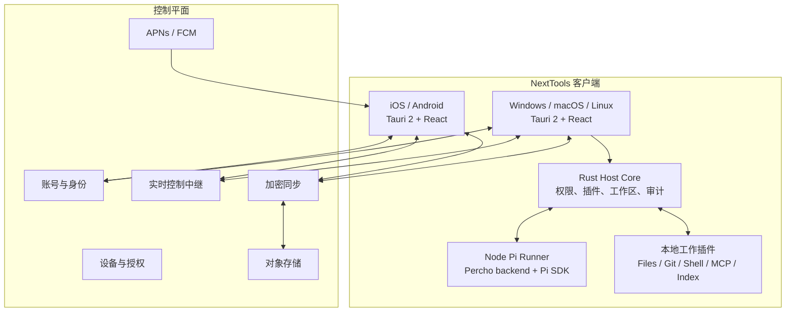

# 总体架构

## 目标

NextTools 是一个 **local-first、多端同步、插件化的 Agent 工作台**：

- 桌面端运行本地开发 Agent、文件/Git/Shell/MCP/索引等工作插件。
- iOS 和 Android 运行跨端 UI/API 插件，并控制已配对、在线的桌面 Agent Host。
- Agent 通过受控工具调用参与本地工作插件能力。
- 账号服务负责身份、设备、工作区访问、同步和实时中继；它不执行用户的本地任务。

## 不做

- 不把 Electron 和 Tauri 作为并行的主客户端。
- 不在 iOS/Android 本机运行 Node、Pi、Shell、Git 或 MCP server。
- 不让前端、插件或手机绕过桌面 Host 直接获取系统能力。
- 不下载执行未签名 native/Rust/Node 插件。

## 拓扑



## 技术选型

| 层 | 选择 | 责任 |
|---|---|---|
| 客户端宿主 | Tauri 2 | 平台窗口、移动端、原生 bridge、最小权限能力 |
| UI | React + TypeScript + Vite | 工作台、插件视图、会话时间线、审批卡 |
| 状态 | Zustand | 流式会话、工具状态、跨面板 UI 状态 |
| 桌面内核 | Rust | SQLite、权限、审计、文件/Git/Shell 代理、sidecar 管理 |
| 本地数据 | SQLite + 加密附件缓存 | local-first 工作区状态 |
| Pi Agent | Node.js sidecar | Percho backend 和 Pi SDK 的隔离运行时 |
| 控制平面 | TypeScript + Fastify | HTTP API、WebSocket、中继、认证边界 |
| 云端存储 | PostgreSQL、Redis、S3 兼容对象存储 | 元数据、连接状态、事件路由、加密附件 |

## 目标仓库结构

```text
apps/
  client/                 # Tauri + React
  control-plane/          # 账号、设备、中继、同步、推送
crates/
  host-core/              # 插件生命周期、权限、审计
  workspace-core/         # 工作区、任务、产物等领域模型
  local-store/            # SQLite 与迁移
  capability-broker/      # 工具执行和审批
  sidecar-bridge/         # Rust <-> Node JSON-RPC
  sync-client/            # 同步队列与冲突处理
  device-identity/        # 配对、签名、设备凭据
  remote-control/         # 实时控制和策略
packages/
  protocol/               # 共享 schema 与类型
  plugin-sdk/             # manifest、UI/工具 SDK
  ui/                     # 工作台设计系统
plugins/
  pi-agent/
  deepseek-chat/
  workspace-files/
  workspace-git/
  workspace-shell/
  workspace-index/
  mcp-bridge/
vendor/
  percho/                  # Git submodule；固定且已验证的上游 commit
```

以上是完整产品的目标结构，并非当前目录清单。当前已实装 `apps/client`、`crates/{host-core,workspace-core,local-store,capability-broker}`、`packages/{protocol,plugin-sdk,ui}`、`plugins/{pi-agent,workspace-files}` 与 `vendor/percho`；控制平面、同步、设备身份、远控及其余工作插件仍在后续阶段。

## 客户端责任边界

```text
React UI
  -> Tauri command/event
  -> Rust Host
  -> capability broker
  -> 本地插件或 Node Runner
```

React 只显示状态和发出意图。Rust Host 是文件、Git、Shell、凭据使用和 sidecar 的唯一门面；Node Pi Runner 不能绕过 Host 访问本地工作区能力；服务端只路由、同步和授权，不执行 Agent 工具调用。
