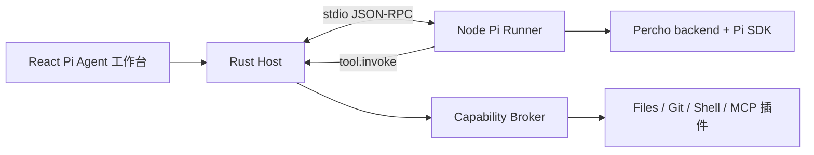

# Pi Agent / Percho 集成

## 决策

`pi-agent` 是一个桌面端官方 Agent runtime 插件。它复用 Percho 的 Node/TypeScript backend 和 Pi SDK 逻辑，但由 NextTools 的 Rust Host 控制权限、UI、设备远控和工作区工具。

不重写 Pi/Percho 的 Agent 语义。重新实现会导致会话、上下文、项目资源、权限、MCP、skills、extensions 和子 Agent 行为长期偏离上游。

## 事实与许可

- Percho 是 Pi coding agent 的桌面 GUI，backend 依赖 `@earendil-works/pi-coding-agent`。
- `packages/backend/src/pi-backend.ts` 是与 Electron 解耦的 Pi SDK 门面；适合封装到独立 Runner。
- Percho 使用 MIT 许可。复用实质代码时，项目源码和发布物必须包含其版权声明和 MIT 许可文本。

参考：

- <https://github.com/Jaxton07/percho>
- <https://raw.githubusercontent.com/Jaxton07/percho/main/packages/backend/src/pi-backend.ts>
- <https://raw.githubusercontent.com/Jaxton07/percho/main/LICENSE>

## 上游跟进策略

`@percho/backend` 是上游的 private 仓库内部包，且依赖 `@percho/shared`；它没有面向第三方的稳定 SDK 承诺。因此 NextTools 必须将上游与自身差异隔离：

```text
vendor/percho/                     # Git submodule，固定上游 commit
  packages/backend/
  packages/shared/
  packages/desktop/                # 保留来源；不作为 NextTools 客户端运行
plugins/pi-agent/
  manifest.json
  runner/                          # NextTools 薄适配层
    src/index.mjs                 # JSON-RPC 生命周期和 Percho 会话桥接
    src/percho-host-bridge.mjs
    src/host-tools.mjs
    scripts/build.mjs
    scripts/package-runtime.mjs
```

- 不复制后端后在副本内混入 NextTools 功能；差异只落在 `plugins/pi-agent/runner`。
- 不直接追踪上游 `main`，不在运行时下载或替换 Runner。每个 NextTools 发布版本固定一个已经验证的 Percho commit 和 Pi SDK 版本。
- 上游 Agent 行为、会话、模型、provider、skills、extensions、MCP 和 subagent 的修复可跟进；Electron shell、preload、窗口、自动更新不能直接复用。
- 需要修改上游时，补丁必须小而独立、可追踪；可上游化的补丁优先提交给 Percho。

### 升级流程

```text
选择上游 commit
  -> 审阅 backend/shared/Pi 依赖变化
  -> 更新 submodule
  -> 调整薄适配层与版本化协议
  -> 验证创建/恢复会话、流式、取消、工具、审批、扩展与打包
  -> 固定到 NextTools 发布版本
```

上游 UI 变化和后端升级分开评估。桌面 UI 维持 Percho 布局，但只能有意识地迁移 React 页面和交互，不能复制 Electron 运行时。

## 当前实现目录

```text
plugins/pi-agent/
  manifest.json
  runner/
    src/index.mjs                 # JSON-RPC 入口、会话生命周期和模型目录
    src/percho-host-bridge.mjs    # 对 Percho PiBackend 的唯一兼容层
    src/host-tools.mjs            # 文件、Git、Shell、Skill 与 MCP 工具代理
    scripts/build.mjs
    scripts/package-runtime.mjs   # 打包固定 Node runtime 与许可文件
    package.json
    licenses/
apps/client/src-tauri/src/
  agent.rs                        # Runner 生命周期、审批、事件与工具调度
  agent_settings.rs               # 模型、系统凭据与 Skills
  agent_mcp.rs                    # stdio/HTTP MCP 生命周期
```

Agent 页面当前由 `apps/client/src/App.tsx` 中的宿主 React 页面实现；尚未拆成单独的 `plugins/pi-agent/ui` 包。不得把尚未存在的目标目录写成已实现事实。

## 进程边界



当前 Pi Runner 的职责：

- 运行固定版本的 Node.js、Percho backend 与 Pi SDK。
- 创建、列出、恢复、提示、取消和持久化会话，并将 Percho 事件投影为 NextTools `agent:event`。
- 使用 Host 提供的模型凭据、Skill 元数据和 MCP 工具定义组装每个会话。
- 将所有工作区、Git、Shell、Skill 和 MCP 调用通过 `tool.invoke` 交回 Host。

Rust Host 负责 Runner 进程生命周期、90 秒单次审批、能力校验、审计、系统凭据和实际工具执行。当前实现关闭 Percho 自动加载的 extensions、内建 MCP、项目上下文文件和其他本地资源入口，避免 Runner 绕过 Host。Pi Runner 不拥有文件、Git、Shell、系统凭据或远控的最终权限。

## Host 与 Runner 协议

所有消息均为带 `version: 1` 的单行 JSON-RPC 风格消息，通过 stdin/stdout 传输；不复用 Electron IPC，也不打开本地 HTTP 监听端口。当前方法为：

```ts
type HostToRunner =
  | { method: "runner.health" }
  | { method: "models.list" }
  | { method: "session.list"; params: ListSessions }
  | { method: "session.create"; params: OpenSession }
  | { method: "session.resume"; params: OpenSession }
  | { method: "session.prompt"; params: PromptSession }
  | { method: "session.abort"; params: { sessionId: string } }
  | { method: "session.dispose"; params: { sessionId: string } };

type RunnerToHost =
  | { method: "agent.event"; params: { sessionId: string; event: unknown } }
  | { id: string; method: "tool.invoke"; params: ToolInvocation };
```

Host 生成 live session ID，并把工作区、会话目录、provider、model、内存中的 API key 及受控资源定义发送给 Runner。Runner 回调工具时必须携带 live session ID；Host 由该 ID 重新取得工作区，不能信任 Runner 自报路径或权限。Runner 请求、Host 工具请求和审批均有超时；Runner 异常退出时 Host 清空 live session 与未完成审批，持久化会话仍可重新恢复。

## Pi Extension UI

当前 Runner 明确设置 `noExtensions`，尚未向 Agent 暴露 Pi Extension UI。后续启用时必须使用 Pi 的 `rpc` 语义，而不是冒充 `tui`：

- 支持 `select`、`input`、`editor`、`confirm`、`notify`。
- 正确传递取消、超时和 `AbortSignal`。
- 终端组件类 API 必须明确降级；不能返回假成功。
- 用户取消才可返回取消值；不能伪造默认选项或输入。
- 扩展错误必须写入 Agent trace 和用户可见的错误卡。

## 平台边界

Pi Runner 只在 Windows、macOS、Linux 完整运行。手机端可使用 `remote-controller` 视图：会话浏览、prompt、停止、事件流、产物和策略允许的审批，但不启动 Node/Pi/Shell/Git/MCP。

Tauri sidecar 用于桌面端捆绑 Runner；每种目标平台都需要对应二进制。参考：<https://v2.tauri.app/develop/sidecar/>。
