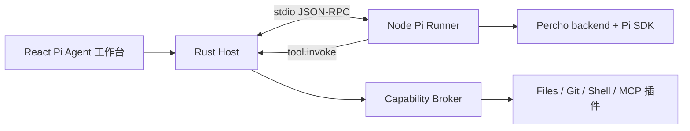

# Pi Agent / Percho 集成

## 决策

`pi-agent` 是一个桌面端官方 Agent runtime 插件。它复用 Percho 的 Node/TypeScript backend 和 Pi SDK 逻辑，但由 NextTools 的 Rust Host 控制权限、UI、设备远控和工作区工具。

不重写 Pi/Percho 的 Agent 语义。重新实现会导致会话、上下文、项目资源、权限、MCP、skills、extensions 和子 Agent 行为长期偏离上游。

## 事实与许可

- Percho 是 Pi coding agent 的桌面 GUI，backend 依赖 `@earendil-works/pi-coding-agent`。
- `packages/backend/src/pi-backend.ts` 是与 Electron 解耦的 Pi SDK 门面；适合封装到独立 Runner。
- Percho 使用 MIT 许可。复用实质代码时，项目源码和发布物必须包含其版权声明和 MIT 许可文本。

参考：

- <https://github.com/Jaxton07/percho>
- <https://raw.githubusercontent.com/Jaxton07/percho/main/packages/backend/src/pi-backend.ts>
- <https://raw.githubusercontent.com/Jaxton07/percho/main/LICENSE>

## 上游跟进策略

`@percho/backend` 是上游的 private 仓库内部包，且依赖 `@percho/shared`；它没有面向第三方的稳定 SDK 承诺。因此 NextTools 必须将上游与自身差异隔离：

```text
vendor/percho/                     # Git submodule，固定上游 commit
  packages/backend/
  packages/shared/
  packages/desktop/                # 保留来源；不作为 NextTools 客户端运行
plugins/pi-agent/
  runner/                          # NextTools 薄适配层
    src/percho-adapter.ts
    src/host-tools.ts
    src/host-ui-context.ts
    src/session-bridge.ts
```

- 不复制后端后在副本内混入 NextTools 功能；差异只落在 `plugins/pi-agent/runner`。
- 不直接追踪上游 `main`，不在运行时下载或替换 Runner。每个 NextTools 发布版本固定一个已经验证的 Percho commit 和 Pi SDK 版本。
- 上游 Agent 行为、会话、模型、provider、skills、extensions、MCP 和 subagent 的修复可跟进；Electron shell、preload、窗口、自动更新不能直接复用。
- 需要修改上游时，补丁必须小而独立、可追踪；可上游化的补丁优先提交给 Percho。

### 升级流程

```text
选择上游 commit
  -> 审阅 backend/shared/Pi 依赖变化
  -> 更新 submodule
  -> 调整薄适配层与版本化协议
  -> 验证创建/恢复会话、流式、取消、工具、审批、扩展与打包
  -> 固定到 NextTools 发布版本
```

上游 UI 变化和后端升级分开评估。桌面 UI 维持 Percho 布局，但只能有意识地迁移 React 页面和交互，不能复制 Electron 运行时。

## 目录

```text
plugins/pi-agent/
  manifest.json
  ui/
    AgentWorkbench.tsx
    SessionTimeline.tsx
    ToolCallCard.tsx
    ApprovalDock.tsx
    DiffPanel.tsx
    SubagentPanel.tsx
  runner/
    src/index.ts
    src/percho-adapter.ts
    src/host-tools.ts
    src/host-ui-context.ts
    src/session-bridge.ts
    package.json
  NOTICE
```

## 进程边界



Pi Runner 的职责：

- 运行 Node.js、Percho backend 与 Pi SDK。
- 管理会话、模型、provider、skills、Pi extensions、MCP 和 subagents。
- 将 Pi 事件投影为 NextTools `AgentEvent`。
- 将 Pi extension 的 GUI 请求转成 Host UI 请求。
- 将 Agent 工具调用转交 Host。

Pi Runner 不拥有文件、Git、Shell、系统凭据或远控的最终权限。

## Host 与 Runner 协议

所有消息均为版本化 JSON-RPC，通过 stdin/stdout 传输；不复用 Electron IPC，也不打开本地 HTTP 监听端口。

```ts
type HostToRunner =
  | { method: "session.create"; params: CreateSession }
  | { method: "session.prompt"; params: PromptSession }
  | { method: "session.abort"; params: { sessionId: string } }
  | { method: "approval.resolve"; params: ApprovalResolution }
  | { method: "ui.resolve"; params: ExtensionUiResolution }
  | { method: "tool.result"; params: ToolResult };

type RunnerToHost =
  | { method: "agent.event"; params: AgentEvent }
  | { method: "approval.request"; params: ApprovalRequest }
  | { method: "ui.request"; params: ExtensionUiRequest }
  | { method: "tool.invoke"; params: ToolInvocation }
  | { method: "runner.health"; params: RunnerHealth };
```

每个请求必须带协议版本、会话 ID、工作区 ID、请求 ID 和超时。Host 要在 Runner 异常退出时使未完成审批失效，并将会话标为可恢复或失败。

## Pi Extension UI

应使用 Pi 的 `rpc` 语义，而不是冒充 `tui`：

- 支持 `select`、`input`、`editor`、`confirm`、`notify`。
- 正确传递取消、超时和 `AbortSignal`。
- 终端组件类 API 必须明确降级；不能返回假成功。
- 用户取消才可返回取消值；不能伪造默认选项或输入。
- 扩展错误必须写入 Agent trace 和用户可见的错误卡。

## 平台边界

Pi Runner 只在 Windows、macOS、Linux 完整运行。手机端可使用 `remote-controller` 视图：会话浏览、prompt、停止、事件流、产物和策略允许的审批，但不启动 Node/Pi/Shell/Git/MCP。

Tauri sidecar 用于桌面端捆绑 Runner；每种目标平台都需要对应二进制。参考：<https://v2.tauri.app/develop/sidecar/>。
